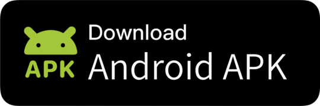
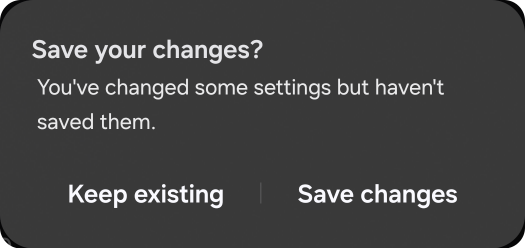
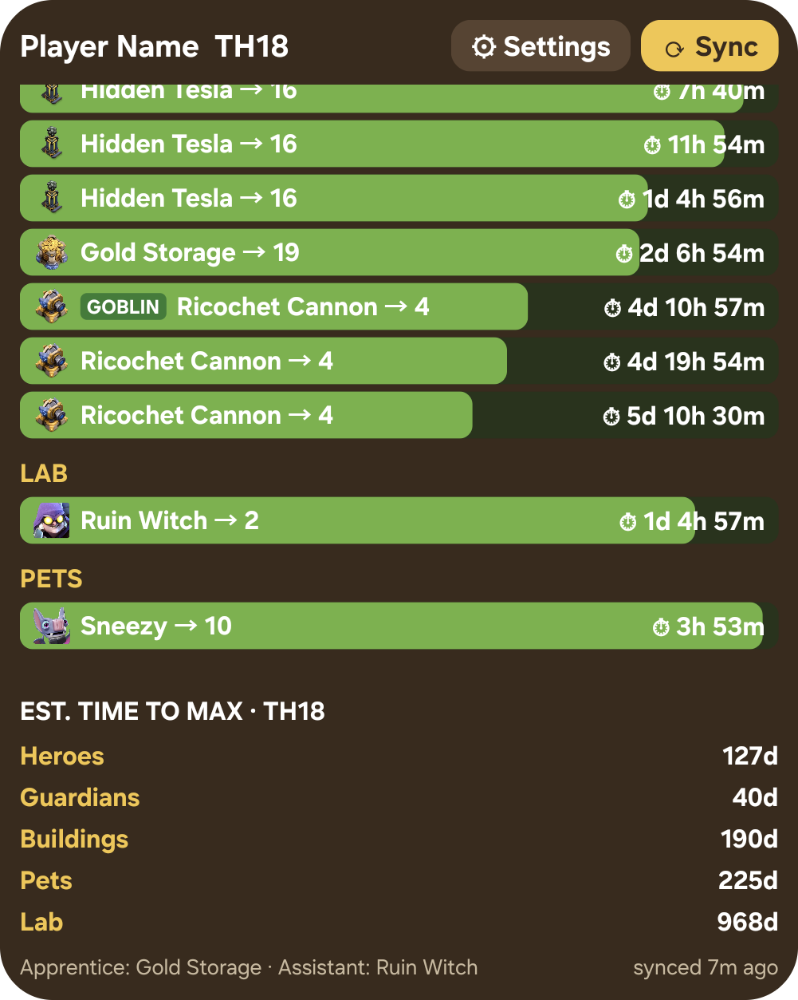
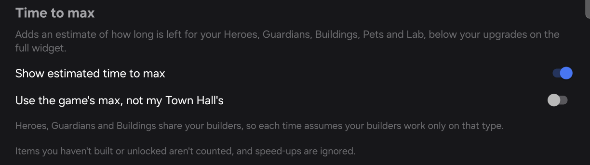
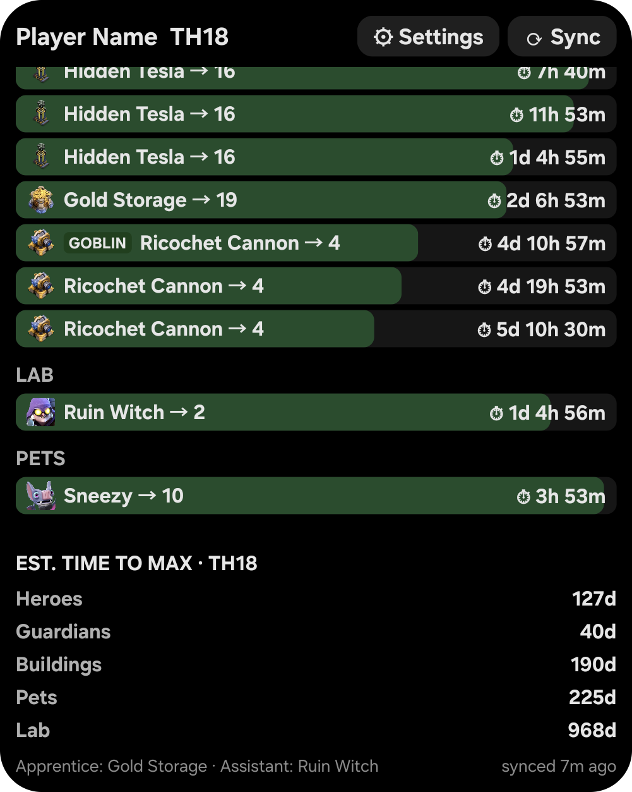

# Builder Timer Widget

Android home-screen widgets that track your Clash of Clans builder, lab and pet upgrades, with a notification when each one finishes.

<p align="center"></p>

**[Download the latest APK](https://github.com/ww40/coc-widget/releases/latest)**

<a href="https://github.com/ww40/coc-widget/releases/download/v0.1.10/builder-timer-widget-v0.1.10.apk"></a>

- **Full widget:** every builder, lab and pet upgrade with icons, progress bars and countdowns (or finish times). Finished rows turn gold and the header shows free builders.
- **Compact 2×1 widget:** the next upgrade to finish and how many builders are free.
- **Notifications** when upgrades finish, with optional quiet hours that hold overnight alerts until morning.
- **Private:** the app has no internet permission. Your village data never leaves your phone.

## Install

Needs Android 8.0 or later. There's no iPhone version.

1. Download the APK using the button above, on your phone.
2. Open the file and tap **Install**. If asked, allow your browser or file manager to install unknown apps.
   - **Samsung:** turn off **Settings → Security and privacy → Auto Blocker** first, then turn it back on afterwards.
3. Open **Builder Timer Widget** once and allow notifications.

## Set up

1. Long-press an empty spot on your home screen, tap **Widgets**, then find **Builder Timer Widget**.
2. Drag a widget onto your home screen: the full widget, or the small **Next upgrade** one.
3. Recommended: add the **Sync timers** tile, so you can sync without leaving the game. Swipe down from the top of the screen to open quick settings, tap the edit button (a pencil), then add **Sync timers**.
   - **Samsung:** tap the pencil, then **Add a control**, scroll to **Builder Timer Widget** and tap **Sync timers**. It appears as a circular arrow, and you can press and hold it to move it.
4. Optional: tap **⚙ Settings** on the full widget to add your player name. The export only includes your player tag.
5. If notifications arrive late, set the app's battery usage to **Unrestricted** in your phone's settings. The exact wording varies by phone.

## How to use it

The official Clash of Clans API doesn't expose upgrade timers, so the widget works from a copy of your village data. It only knows what was true when you last synced.

### Sync your village

1. In Clash of Clans, go to **Settings → More Settings → Data Export → Copy**.
2. Swipe down from the top of the screen and tap **Sync timers**, or tap **⟳ Sync** on the full widget.
3. Look for the **Synced N upgrades** message.

With the tile, you stay in the game. The **⟳ Sync** button means going to your home screen first.

### When to sync again

Sync whenever something changes in the game:

- You start an upgrade.
- You finish one early with gems, a book or a hammer.
- You use a potion.
- You assign a helper, or a new helper shift starts.

The footer shows an amber **re-sync** once an upgrade has finished since your last sync, or that sync is over a day old.

### A typical day

1. A notification tells you an upgrade has finished. Tap it to open Clash of Clans.
2. Start your next upgrade.
3. Copy the export and tap **Sync timers**, so the widget and your next notification are right.

Between upgrades, the widget shows what's running and when your next builder, lab or Pet House is free. Tapping an upgrade row or the footer opens Clash of Clans, as does tapping anywhere else on the compact widget. The full widget's header row doesn't, so a missed tap on **Settings** or **Sync** won't launch the game.

### Potions and helpers

Use the potion or assign the helper first, then sync. Timers then include the speed-up, so they'll show less time than the game does. That's expected: the game shows upgrade times as if no speed-up were running, and the widget shows when upgrades will really finish.

### Planning ahead

- **Finish times:** turn on **Show finish time instead of countdown** in [Settings](#settings) to see "Tue 14:30" rather than "2d 5h 54m".
- **Overnight:** set **Quiet hours** so upgrades finishing while you sleep notify you when the window ends.
- **The long game:** turn on [Time to max](#time-to-max) for a rough idea of what's left for each type.

## Reading the widget

- **Rows:** each upgrade shows its progress and time left, or its finish time if you turned that on. A finished row turns gold.
- **Header:** shows how many builders are free.
- **Goblin badge:** marks an upgrade being run by the event Goblin.
- **Potion icon:** shows the time left on an active potion. Timers already include it, so the widget shows less time than the game.
- **Apprentice and Assistant:** the footer counts down until each helper can take a new job, then turns amber.
- **Amber "re-sync" footer:** an upgrade has finished since your last sync, or that sync is over a day old.

## Troubleshooting

- **"No village data found":** your clipboard doesn't hold the export. Copy it in the game again, then sync straight away.
- **"Village data is out of date":** the export you copied is over an hour old. Copy a fresh one, or tap **Use anyway**.
- **A timer looks wrong:** sync again. The widget can't see anything that changed since your last sync.
- **No notifications:** check they're allowed for Builder Timer Widget in your phone's app settings.

## What it can't show

- **Resources:** gold, elixir and dark elixir aren't in the export.
- **More than one account:** the widget holds one village, so syncing another account replaces it.
- **Builder Base:** these upgrades aren't shown.
- **Builder Bite and Study Soup:** these are timed as full potions, so finish times will look too early.
- **Future helper shifts:** only a shift running at your last sync is counted. With **Keep assigned**, sync after each new shift starts.

## Settings

Open settings with the **⚙ Settings** button on the widget, by long-pressing a widget and choosing **Settings**, or from the app icon.

<p align="center"></p>

- **Player name:** shown in the widget header (the export only contains your player tag).
- **Show finish time instead of countdown:** e.g. "Tue 14:30" rather than "2d 5h 54m".
- **Dark mode for widgets:** swaps the Clash-style colours on both widgets for true black and greys.
- **Show estimated time to max:** adds a section under the upgrades with a time for Heroes, Guardians, Buildings, Pets and Lab, or **✓ Maxed**. A second switch measures against the game's highest levels instead of your Town Hall's.
- **Quiet hours:** notifications for upgrades finishing in this window arrive when it ends instead.

Tap **Save** to apply; widgets update within a minute. Pressing Back with unsaved changes asks whether to save them or keep the existing settings.

<p align="center"></p>

### Time to max

Turn on **Show estimated time to max** to add a section under your upgrades on the full widget, with a rough time for each type. Scroll the widget if the section doesn't fit.

<p align="center"></p>

<p align="center"></p>

### Dark mode

Turn on **Dark mode for widgets** to switch both widgets to true black and greys.

<p align="center"></p>

## Updating

Download the newest APK from [Releases](https://github.com/ww40/coc-widget/releases/latest) and open it to install over the old version. Your widgets, settings and last sync are kept.

To get updates automatically, install [Obtainium](https://github.com/ImranR98/Obtainium) and add `https://github.com/ww40/coc-widget`. Or click **Watch → Custom → Releases** on this repo for an email when a new version is out.

## Build

Requires JDK 17 and the Android SDK (platform 35). Set `sdk.dir` in `local.properties`, then:

```bash
./gradlew :app:testDebugUnitTest   # unit tests
./gradlew :app:assembleDebug       # debug APK
./gradlew :app:assembleRelease     # signed release APK (needs signing config below)
```

### Release signing

Release builds are signed with credentials read from Gradle properties (e.g. `~/.gradle/gradle.properties`) or environment variables, never from the repo:

```properties
BUILDERTIMER_KEYSTORE=/path/to/buildertimer-release.jks
BUILDERTIMER_KEYSTORE_PASSWORD=...
BUILDERTIMER_KEY_ALIAS=buildertimer
BUILDERTIMER_KEY_PASSWORD=...
```

Android only installs updates signed with the same key, so back the keystore and its password up somewhere safe. Losing them means users must uninstall to update.

## Game data

`app/src/main/assets/game_data.json` maps export IDs to names and per-level upgrade durations, which drive the progress bars. It's generated from [ClashKing's static data](https://github.com/ClashKingInc/ClashKingAssets) (served at assets.clashk.ing/static_data). Regenerate it after a game update:

```bash
python3 tools/generate_game_data.py
```

Items the static data omits can be named (and given `upgradeSeconds`) in `tools/game_data_overrides.json`, which the generator merges in. Anything else missing shows as `Unknown (<id>)` with an empty progress bar.

## Icons

`app/src/main/res/drawable-nodpi/icon_<dataId>[_<level>].webp` are item icons from [ClashKing's assets](https://github.com/ClashKingInc/ClashKingAssets) (served at assets.clashk.ing), which ask for credit when used. Buildings and traps have one icon per level. Refresh them after regenerating game data:

```bash
python3 tools/fetch_icons.py
```

Items without an icon show a section emoji (🔨 builders, ⚗️ lab, 🐾 pets). `potion_builder.webp`, `potion_research.webp` and `potion_pet.webp`, shown with the time left on an active potion, are ClashKing's `magic_items/builder_potion.webp`, `magic_items/research_potion.webp` and `magic_items/pet_potion.webp`.

## Behaviour notes

- Countdowns are minute-precision; widgets refresh every minute while the device is awake.
- Finish notifications use inexact alarms, so they may arrive a few minutes late under Doze.
- Active Builder, Research and Pet Potions are included in finish times, so during a potion the widget shows less time than the game.
- A helper's current shift is included in finish times, adding its level to the upgrade's speed (a level 8 helper runs at 9x, or 18x during a Builder Potion). That speed comes from the game's data and hasn't been measured against the game.
- Time to max is a rough estimate from your last sync. Heroes, Guardians and Buildings share your builders, so each time assumes your builders work only on that type, and the times don't add up to an overall total. Items you haven't built or unlocked aren't counted, and speed-ups such as potions, helpers and Gold Pass are ignored.
- Timers are only as current as the last sync; the widget footer turns amber once an upgrade has finished since the last sync, or that sync is over a day old.

## Credits and licence

Code is MIT licensed (see [LICENSE](LICENSE)). Item icons and game data by ClashKing.

This material is unofficial and is not endorsed by Supercell. For more information see Supercell's [Fan Content Policy](https://supercell.com/fan-content-policy).
