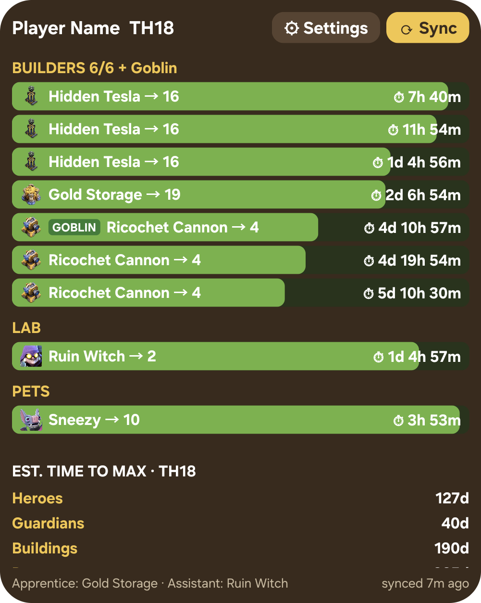
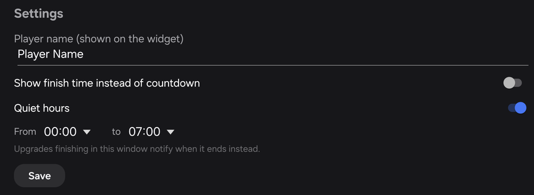

# Builder Timer Widget

Android home-screen widgets that track your Clash of Clans builder, lab and pet upgrades, with a notification when each one finishes.

<p align="center"></p>

**[Download the latest APK](https://github.com/ww40/coc-widget/releases/latest)**

- **Full widget:** every builder, lab and pet upgrade with icons, progress bars and countdowns (or finish times). Finished rows turn gold and the header shows free builders.
- **Compact 2×1 widget:** the next upgrade to finish and how many builders are free.
- **Notifications** when upgrades finish, with optional quiet hours that hold overnight alerts until morning.
- **Private:** the app has no internet permission. Your village data never leaves your phone.

## How it works

The official Clash of Clans API doesn't expose upgrade timers, so the app reads the game's own export:

1. In Clash of Clans: **Settings → More Settings → Data Export → Copy**.
2. Tap **⟳ Sync** on the widget. It reads the export from your clipboard.

Re-sync whenever you start or boost upgrades. Tapping anywhere else on a widget opens Clash of Clans.

## Settings

Open settings with the **⚙** button on the widget, by long-pressing a widget and choosing **Settings**, or from the app icon.

<p align="center"></p>

- **Player name:** shown in the widget header (the export only contains your player tag).
- **Show finish time instead of countdown:** e.g. "Tue 14:30" rather than "2d 5h 54m".
- **Quiet hours:** notifications for upgrades finishing in this window arrive when it ends instead.

Tap **Save** to apply; widgets update within a minute.

## Build

Requires JDK 17 and the Android SDK (platform 35). Set `sdk.dir` in `local.properties`, then:

```bash
./gradlew :app:testDebugUnitTest   # unit tests
./gradlew :app:assembleDebug       # debug APK
./gradlew :app:assembleRelease     # signed release APK (needs signing config below)
```

### Release signing

Release builds are signed with credentials read from Gradle properties (e.g. `~/.gradle/gradle.properties`) or environment variables, never from the repo:

```properties
BUILDERTIMER_KEYSTORE=/path/to/buildertimer-release.jks
BUILDERTIMER_KEYSTORE_PASSWORD=...
BUILDERTIMER_KEY_ALIAS=buildertimer
BUILDERTIMER_KEY_PASSWORD=...
```

Android only installs updates signed with the same key, so back the keystore and its password up somewhere safe. Losing them means users must uninstall to update.

## Game data

`app/src/main/assets/game_data.json` maps export IDs to names and per-level upgrade durations, which drive the progress bars. It's generated from the static data bundled in the [coc.py](https://pypi.org/project/coc.py/) package:

```bash
pip download --no-deps coc.py -d /tmp/cocpy && unzip -o /tmp/cocpy/coc_py-*.whl -d /tmp/cocpy/ext
python3 tools/generate_game_data.py /tmp/cocpy/ext/coc/static/static_data.json
```

Items coc.py omits (e.g. troops still flagged unreleased when its data was generated) can be named in `tools/game_data_overrides.json`, which the generator merges in. Anything else missing shows as `Unknown (<id>)` with an empty progress bar.

## Icons

`app/src/main/res/drawable-nodpi/icon_<dataId>[_<level>].webp` are item icons from [ClashKing's assets](https://github.com/ClashKingInc/ClashKingAssets) (served at assets.clashk.ing), which ask for credit when used. Buildings and traps have one icon per level. Refresh them after regenerating game data:

```bash
python3 tools/fetch_icons.py
```

Items without an icon show a section emoji (🔨 builders, ⚗️ lab, 🐾 pets).

## Behaviour notes

- Countdowns are minute-precision; widgets refresh every minute while the device is awake.
- Finish notifications use inexact alarms, so they may arrive a few minutes late under Doze.
- Timers are only as current as the last sync; the widget footer turns amber once the last sync is over a day old.

## Credits and licence

Code is MIT licensed (see [LICENSE](LICENSE)). Item icons by ClashKing.

This material is unofficial and is not endorsed by Supercell. For more information see Supercell's [Fan Content Policy](https://supercell.com/fan-content-policy).
